

<picture>
  <source media="(prefers-color-scheme: dark)" srcset="docs/assets/logo-dark-mode.png">
  <source media="(prefers-color-scheme: light)" srcset="docs/assets/logo-light-mode.png">
  
</picture>

 
 

# BuildSync

### A Web-Based Construction Tracking and Client Management System

Built for MCPA Construction and Supply, a design-and-build firm in Bulacan, Philippines.

 

---

## Overview

Building a house in the Philippines usually means a lot of back-and-forth: messages scattered across chat apps, plans sent as photos, cost estimates in spreadsheets, and a site that clients only see when they drive out to it.

BuildSync puts that whole journey in one place. A client sends an inquiry and pins their lot on a map, books a consultation, reviews the quotation, and then follows the build through site photos, milestones, weather delays, and permit status. The MCPA team runs the other side of it from an admin dashboard: reviewing inquiries, issuing quotations, logging site progress, and publishing finished projects to the public showcase.

**Live site:** [www.mcpaconstruction.com](https://www.mcpaconstruction.com)

---

## Features

### For clients

| | |
| :--- | :--- |
| **Inquiry and lot pinning** | Describe the project, budget, and requirements, then drop a pin on the lot using an interactive map with Philippine province, city, and barangay lookup. |
| **Consultations** | Book a face-to-face meeting or an in-browser video consultation. No third-party meeting link needed. |
| **Quotations and contracts** | Receive itemized quotations and contract documents as downloadable PDFs. |
| **Build progress** | Follow each construction stage with photo logs, milestone updates, weather delays, and LGU permit status. |
| **Account security** | Email verification, Google sign-in, and optional face verification for sensitive actions. |
| **Bilingual interface** | Switch the whole site between English and Filipino. |
| **Project assistant** | A chatbot that answers common questions about services, process, and permits, with chat history that follows you across devices. |
| **Project recap** | A story-style summary of a finished build that can be exported as shareable slides. |

### For the MCPA team

| | |
| :--- | :--- |
| **Inquiry pipeline** | Review, filter, and move inquiries through each stage from first contact to contract. |
| **Costing and documents** | Prepare quotations, inquiry summaries, receipts, and legal documents, generated as PDFs. |
| **Receipt scanning** | Upload a payment receipt and have the key details read automatically with OCR. |
| **Site tracking** | Log progress photos, milestones, and delay events per project. |
| **Showcase management** | Publish completed projects to the public portfolio with photos, videos, and specifications. |
| **Role separation** | Clients, staff, and administrators each see only what they should. |

---

## Brand Colors

The palette comes straight from the site's stylesheet: safety amber on near-black, with slate for secondary text and two functional accents for maps and confirmations.

| Role | Name | Hex |
| :--- | :--- | :--- |
| Primary | Safety Amber | `#F59E0B` |
| Emphasis | Deep Amber | `#B45309` |
| Text, light mode | Brand Black | `#121212` |
| Canvas, dark mode | Obsidian | `#080A0E` |
| Surface, dark mode | Slate Paper | `#121620` |
| Secondary text | Brand Slate | `#5B6770` |
| Maps and telemetry | Surveyor Cyan | `#0284C7` |
| Confirmed states | Verified Green | `#10B981` |

**Type:** Plus Jakarta Sans for the interface, Geist Mono for coordinates, amounts, and reference numbers.

**Icons:** SVG only. No emoji anywhere in the product.

---

## Tech Stack

### Frontend

### Backend

### Data

### Hosting and delivery

### How the pieces fit

| Layer | What it does |
| :--- | :--- |
| Next.js on Vercel | Serves the public site, client portal, and admin dashboard. |
| Express on Azure | REST API, real-time events, document generation, and OCR. |
| PostgreSQL (Supabase, with Neon as standby) | Main relational data. The API fails over to Neon if the primary becomes unreachable. |
| Firestore | Chat history and live message sync. |
| Azure Blob Storage | Site photos, videos, and uploaded documents. |

---

## System Design

BuildSync was modeled with data flow diagrams during IT303. The context diagram shows the whole system as one process talking to three external entities: **Client**, **Staff**, and **Administrator**.

### Context Diagram (Level 0)

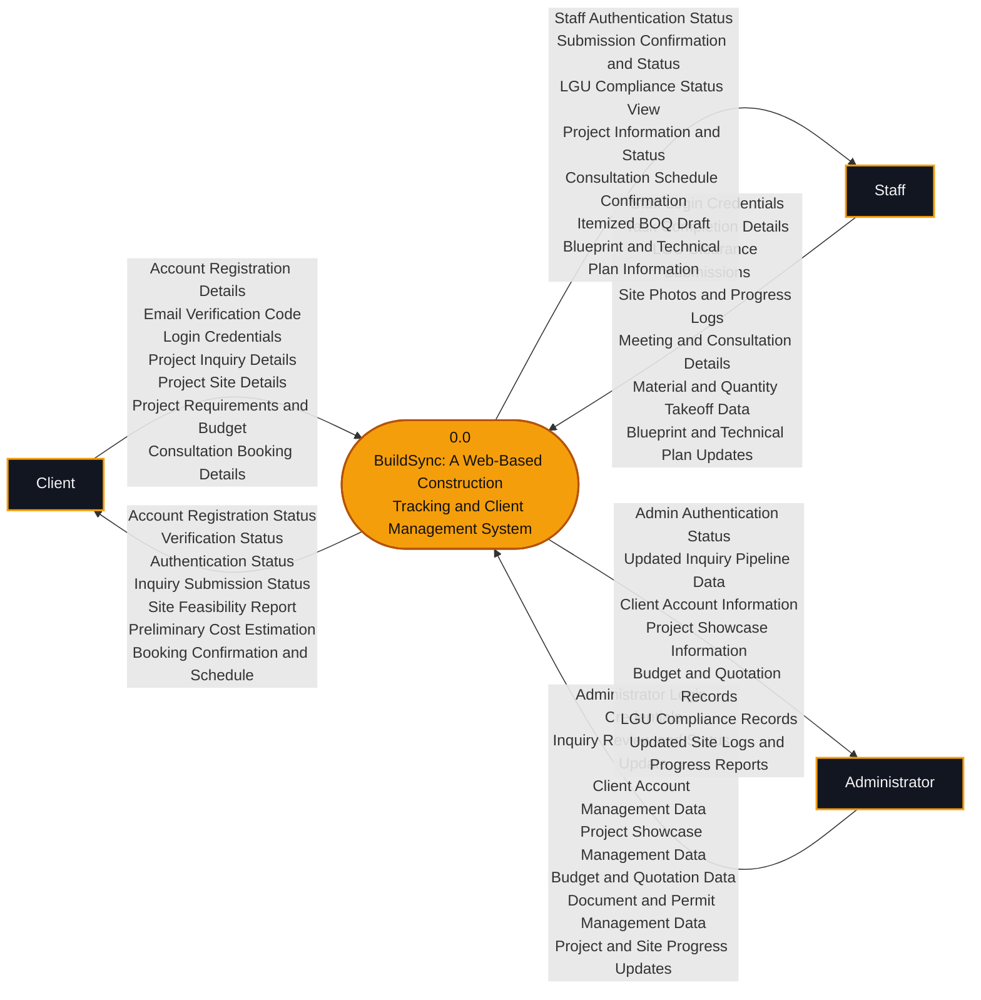

### Level 1 Diagram

The Level 1 diagram breaks the system into eight processes and thirteen data stores. To keep it readable, the arrows between an entity and a process are grouped, with the full list of flows in the table below.

```mermaid
%%{init: {"flowchart": {"nodeSpacing": 40, "rankSpacing": 70, "curve": "linear"}}}%%
flowchart TB
    CLIENT["Client"]
    STAFF["Staff"]
    ADMIN["Administrator"]

    P1(["1.0<br/>Manage User Accounts<br/>and Registration"])
    P2(["2.0<br/>Manage Clients Inquiry<br/>and Project Briefs"])
    P3(["3.0<br/>Manage Feasibility<br/>and Cost Estimation"])
    P4(["4.0<br/>Manage Consultation<br/>and Meetings"])
    P5(["5.0<br/>Manage Blueprints<br/>and Technical Plans"])
    P6(["6.0<br/>Manage Documents<br/>and LGU Compliance"])
    P7(["7.0<br/>Manage Project Execution<br/>and Site Progress"])
    P8(["8.0<br/>Manage Clients Account<br/>and Project Showcase"])

    D1[("D1 Users")]
    D2[("D2 OTP Codes")]
    D3[("D3 Projects")]
    D4[("D4 Client Briefs")]
    D5[("D5 Site Projects")]
    D6[("D6 Site Milestone")]
    D7[("D7 Site Photo Logs")]
    D8[("D8 Email Verification")]
    D9[("D9 Cost Estimates")]
    D10[("D10 Client Quotation")]
    D11[("D11 Blueprints")]
    D12[("D12 Meeting Rooms")]
    D13[("D13 Project Documents")]

    CLIENT <-->|"registration, verification, login"| P1
    CLIENT <-->|"inquiry details"| P2
    CLIENT <-->|"requirements, budget, feasibility, estimate"| P3
    CLIENT <-->|"booking, schedule"| P4

    STAFF <-->|"login"| P1
    STAFF <-->|"takeoff data, BOQ draft"| P3
    STAFF <-->|"meeting details, confirmation"| P4
    STAFF <-->|"plan updates, plan information"| P5
    STAFF <-->|"LGU clearances, compliance status"| P6
    STAFF <-->|"site photos, task logs, status"| P7

    ADMIN <-->|"login"| P1
    ADMIN <-->|"inquiry review, pipeline data"| P2
    ADMIN <-->|"budget, quotation data"| P3
    ADMIN <-->|"permit data, LGU records"| P6
    ADMIN <-->|"progress updates, site reports"| P7
    ADMIN <-->|"account and showcase data"| P8

    P1 <--> D1
    P1 <--> D2
    P1 <--> D8
    P2 <--> D4
    P2 --> D3
    D3 --> P3
    P3 <--> D9
    P3 <--> D10
    P4 <--> D12
    P5 <--> D11
    P6 <--> D13
    P7 <--> D5
    P7 <--> D6
    P7 <--> D7
    P8 <--> D1
    P8 <--> D3

    classDef entity fill:#121620,stroke:#F59E0B,stroke-width:2px,color:#F3F3F3;
    classDef process fill:#F59E0B,stroke:#B45309,stroke-width:2px,color:#121212;
    classDef store fill:#5B6770,stroke:#121620,stroke-width:1px,color:#FFFFFF;
    class CLIENT,STAFF,ADMIN entity;
    class P1,P2,P3,P4,P5,P6,P7,P8 process;
    class D1,D2,D3,D4,D5,D6,D7,D8,D9,D10,D11,D12,D13 store;
```

| # | Process | Main data stores |
| :--- | :--- | :--- |
| 1.0 | Manage user accounts and registration | Users, OTP Codes, Email Verification |
| 2.0 | Manage client inquiry and project briefs | Client Briefs, Projects |
| 3.0 | Manage feasibility and cost estimation | Cost Estimates, Client Quotation |
| 4.0 | Manage consultation and meetings | Meeting Rooms |
| 5.0 | Manage blueprints and technical plans | Blueprints |
| 6.0 | Manage documents and LGU compliance | Project Documents |
| 7.0 | Manage project execution and site progress | Site Projects, Site Milestone, Site Photo Logs |
| 8.0 | Manage client accounts and project showcase | Users, Projects |

<strong>Full data flows per process</strong>

| Process | From entity | To entity |
| :--- | :--- | :--- |
| 1.0 | Client: Account Registration Details, Email Verification Code, Login Credentials. Staff: Staff Login Credentials. Administrator: Administrator Login Credentials. | Client: Account Registration Status, Verification Status, Authentication Status. Staff: Staff Authentication Status. Administrator: Admin Authentication Status. |
| 2.0 | Client: Project Inquiry Details. Administrator: Inquiry Review and Status Update. | Client: Inquiry Submission Status. Administrator: Updated Inquiry Pipeline Data. |
| 3.0 | Client: Project Requirements and Budget. Staff: Material and Quantity Takeoff Data. Administrator: Budget and Quotation Data. | Client: Site Feasibility Report, Preliminary Cost Estimation. Staff: Itemized BOQ Draft. Administrator: Budget and Quotation Records. |
| 4.0 | Client: Consultation Booking Details. Staff: Meeting and Consultation Details. | Client: Booking Confirmation and Schedule. Staff: Consultation Schedule Confirmation. |
| 5.0 | Staff: Blueprint and Technical Plan Updates. | Staff: Blueprint and Technical Plan Information. |
| 6.0 | Staff: LGU Clearance Submissions. Administrator: Document and Permit Management Data. | Staff: LGU Compliance Status View. Administrator: LGU Compliance Records. |
| 7.0 | Staff: Site Photos and Progress Logs, Task Completion Details. Administrator: Project and Site Progress Updates. | Staff: Submission Confirmation and Status, Project Information and Status. Administrator: Updated Site Logs and Progress Reports. |
| 8.0 | Administrator: Client Account Management Data, Project Showcase Management Data. | Administrator: Client Account Information, Project Showcase Information. |

---

## Academic Context

BuildSync was built for **IT303: Systems Analysis and Design** at Bulacan State University (BSIT - 3D1) and has been successfully defended and passed. It continues as our **Capstone Project**, using the analysis and design work from IT303 as its foundation.

### Business Case

MCPA handles every booking and inquiry by hand through Facebook Messenger, text, and email. There is no central record, no way to verify who is booking, and clients who live far from the site have no steady way to see progress. Our business case compared three options and recommended the third.

| Option | Verdict |
| :--- | :--- |
| 1. Do nothing | Free, but leaves manual intake and remote monitoring unsolved, and gets worse as inquiries grow. |
| 2. Do the minimum (a free booking form) | Reduces sorting work, but does not verify identity or intent to pay. |
| 3. Dedicated booking website with client verification | **Recommended.** The only option that solves both problems. |

**Main risks:** staff and client adoption, drop-off from the verification step, and security of client data.

<strong>Read the full Business Case</strong>

 

<table>
  <tr>
    <td><a href="docs/business-case/page-00-cover.jpg">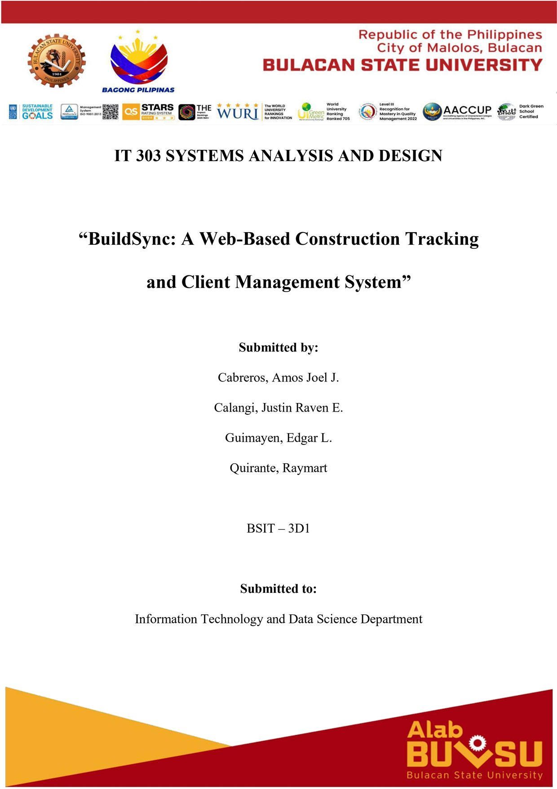</a></td>
    <td><a href="docs/business-case/page-01.jpg">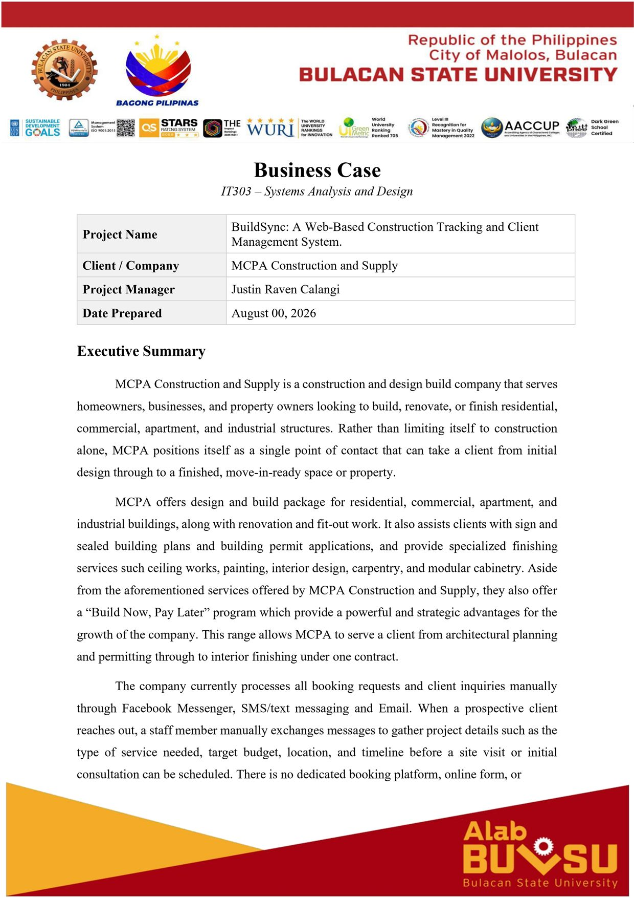</a></td>
    <td><a href="docs/business-case/page-02.jpg">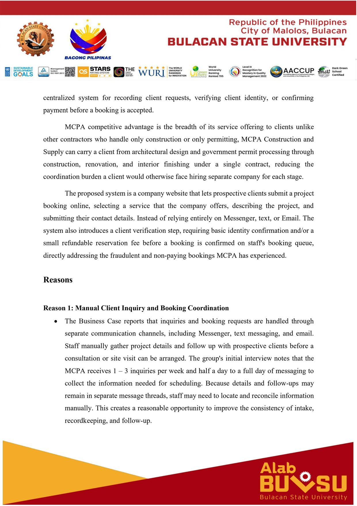</a></td>
    <td><a href="docs/business-case/page-03.jpg">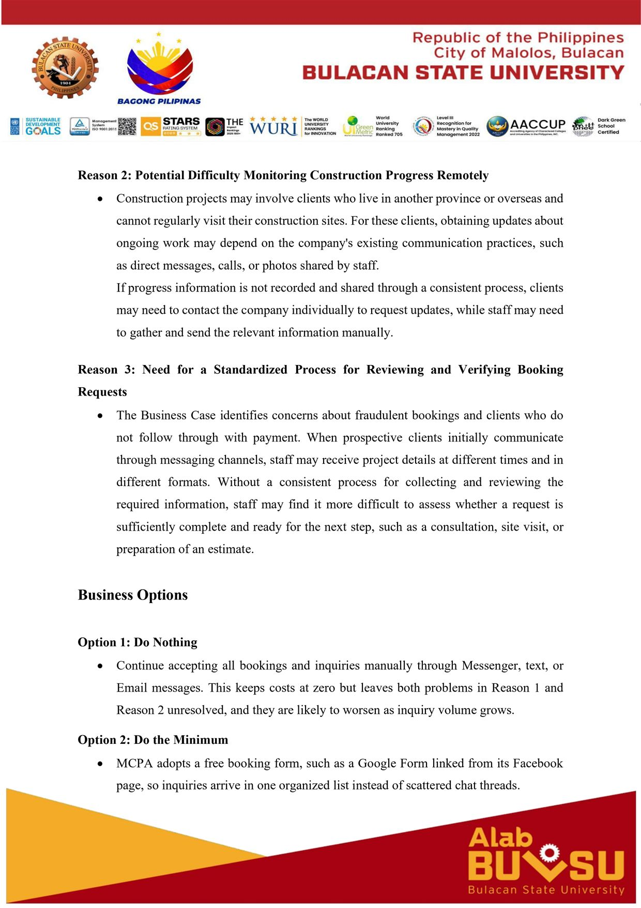</a></td>
  </tr>
  <tr>
    <td><a href="docs/business-case/page-04.jpg">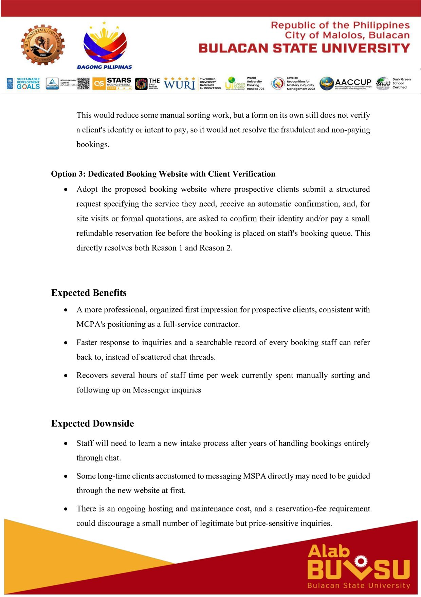</a></td>
    <td><a href="docs/business-case/page-05.jpg">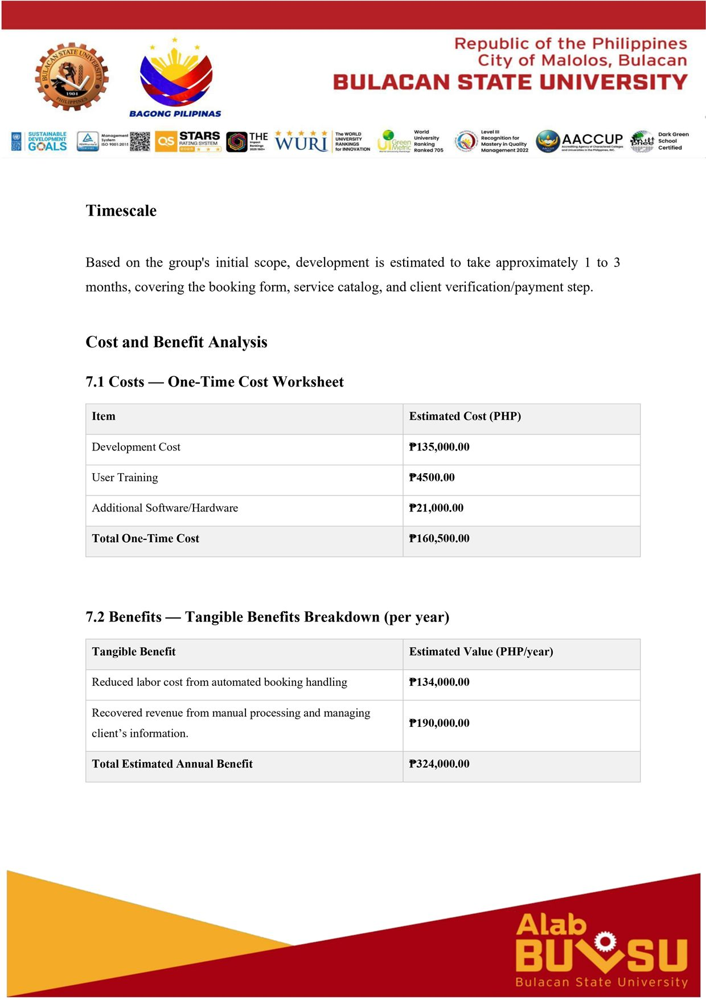</a></td>
    <td><a href="docs/business-case/page-06.jpg">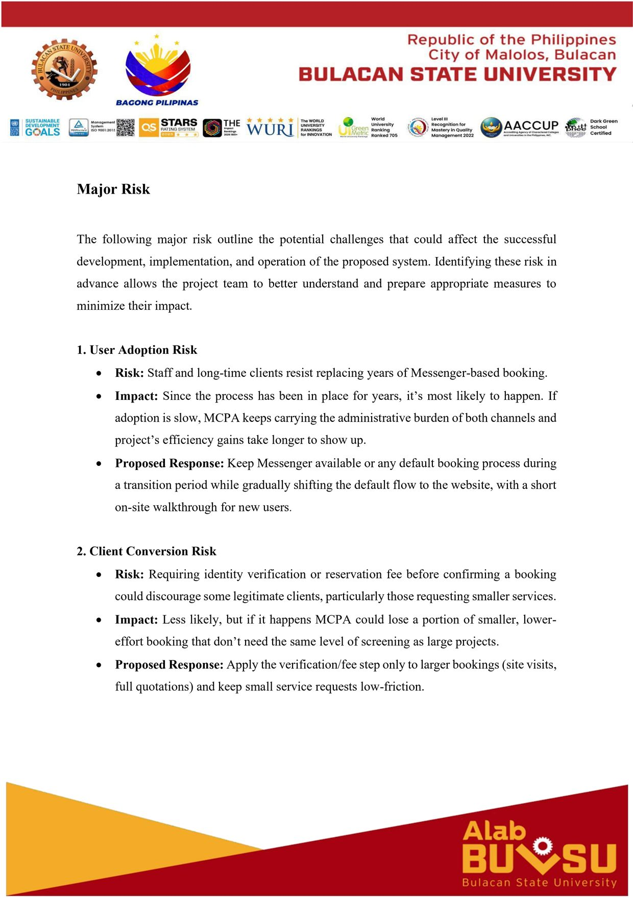</a></td>
  </tr>
</table>

### Defense Day

<table>
  <tr>
    <td width="50%">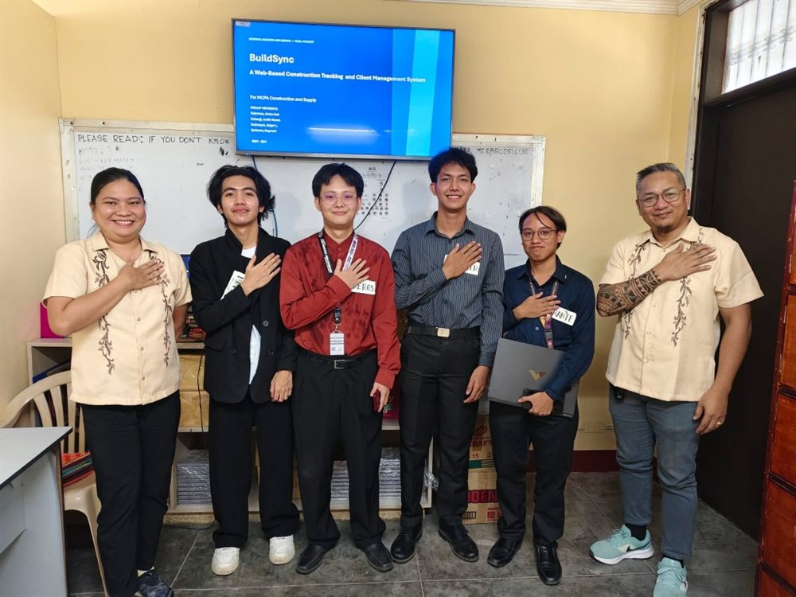</td>
    <td width="50%">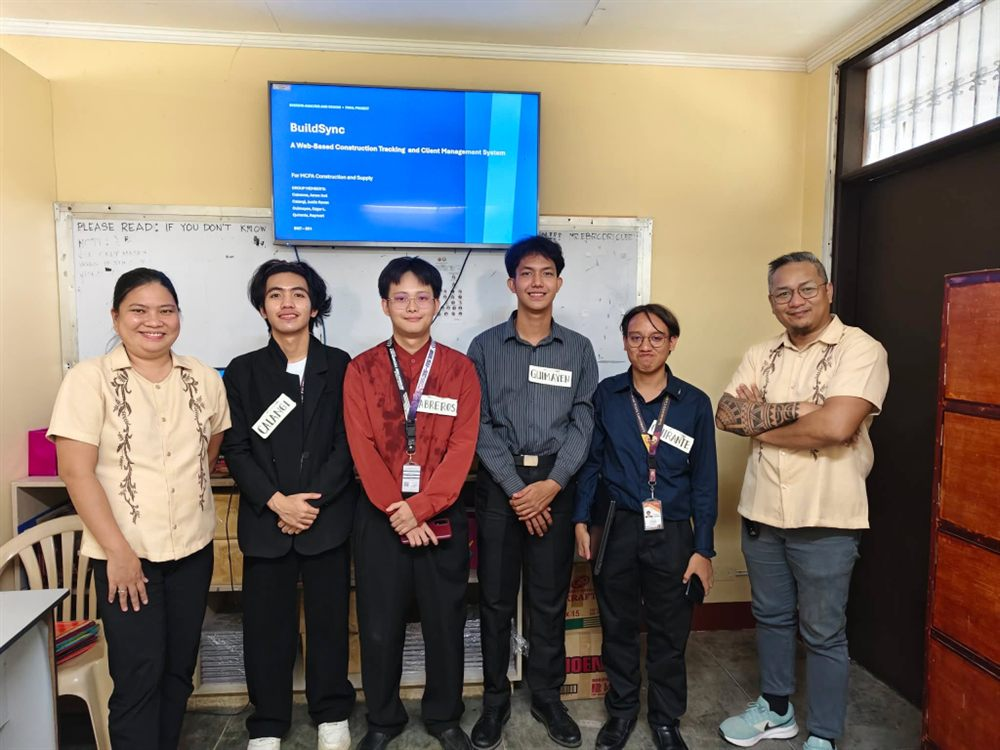</td>
  </tr>
</table>

---

## Project Team

**BSIT - 3D1**

| Member | Role |
| :--- | :--- |
| Calangi, Justin Raven | Project Manager |
| Guimayen, Edgar L. | QA and Documentation |
| Cabreros, Amos Joel | Documentation |
| [Quirante, Raymart](https://github.com/martquirante) | Full Stack Developer |

 

MCPA Construction and Supply · Bulacan, Philippines

